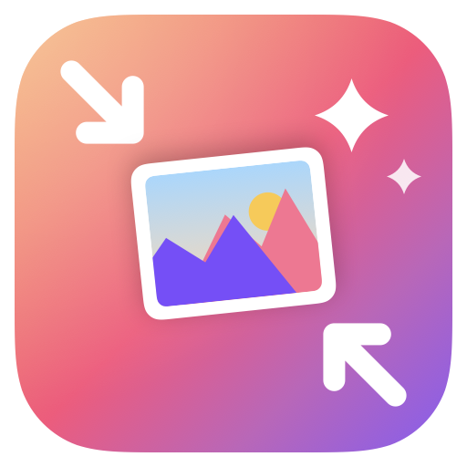
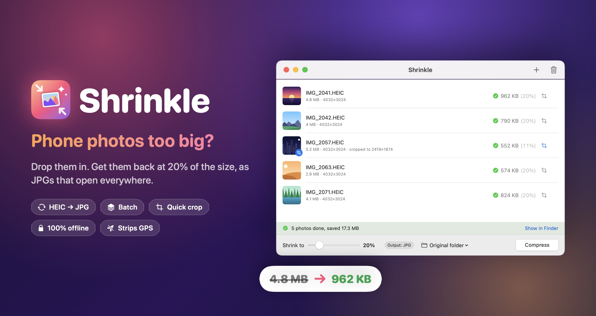
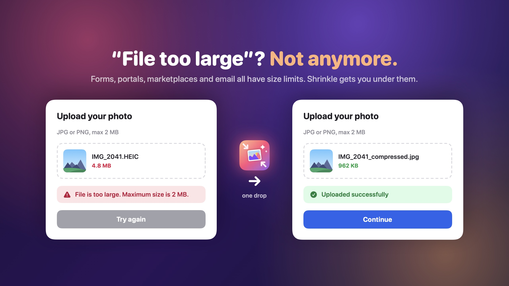
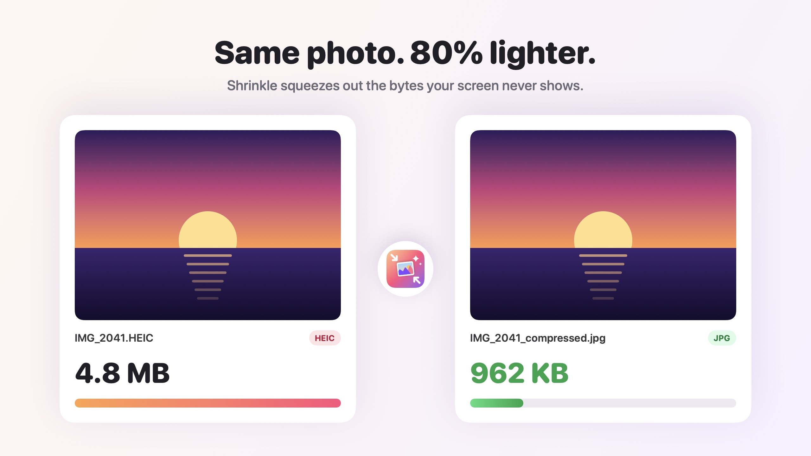
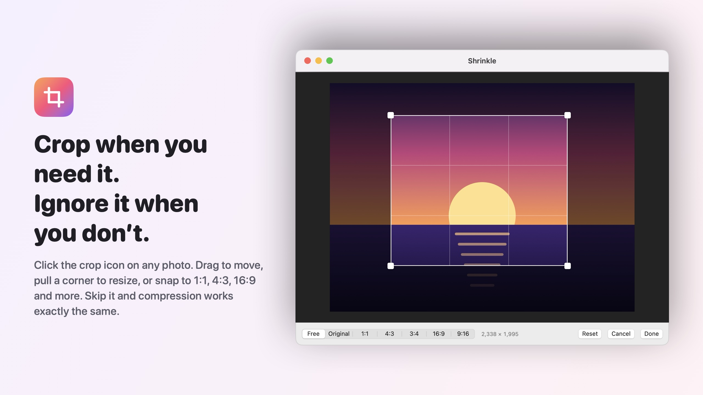

<div align="center">



# Shrinkle

**Phone photos too big? Drop them in, get them back at 20% of the size.**

A tiny, free macOS app that shrinks photos and turns HEIC into JPG. No accounts, no uploads, no fuss.

[](https://github.com/YuanF-661/Shrinkle/releases/latest)


<br>



</div>

## Why Shrinkle?



Phone photos are often 3–10 MB, and iPhones save them as HEIC, which a lot of places won't accept. Shrinkle fixes both in one drop:

| You hit this… | Shrinkle does this |
|---|---|
| 🚫 **"Image too large"** on forms, résumé portals, visa and ID photo uploads | Shrinks to 20% of the size, or whatever you set |
| 🤷 **HEIC not supported** on websites, Windows PCs and older systems | Converts to JPG, which opens everywhere |
| 📧 **Email attachment limit** (usually 20–25 MB) | Fit 5× as many photos in one email |
| 🛍️ **Marketplace listings** with lots of product photos | Batch-shrink for faster uploads and less mobile data |
| ✂️ **Only need part of the photo**: a receipt, a document, a screenshot | Crop it first, then compress |
| 💾 **Running out of space** after a trip | Make small copies for sharing, keep the originals |

> **Tip:** if a site says "max X MB", set the slider to about X ÷ the original size. A 5 MB photo with a 1 MB limit needs about 20%.

## Same photo, 80% lighter



Shrinkle aims for a **target file size**, not a fixed quality setting. It lowers JPG quality first. If the quality would drop far enough to look worse, it scales the image down a little instead. You get the smallest file that still looks right.

## Crop when you need it



Cropping is optional and stays out of your way. Click the crop icon on a photo (or double-click the row), drag the box, pull a corner, or snap to **Free, Original, 1:1, 4:3, 3:4, 16:9 or 9:16**. Skip it and nothing changes.

## Features

- ⚡ **One drop, one click**: drag in photos or a whole folder, or drop them onto the Dock icon
- 🎚️ **Adjustable target**: 20% by default, anywhere from 5% to 90%
- 🔄 **Any format in, JPG out**: HEIC, PNG, TIFF, WebP and more. Photos are rotated upright and transparent backgrounds become white
- 🧵 **Fast batch processing**: several photos are compressed in parallel
- 🛡️ **Originals stay untouched**: output is saved as `name_compressed.jpg`, next to the original or in a folder you pick
- 📍 **Privacy built in**: keeps capture date and camera info, strips GPS location
- ✈️ **100% offline**: nothing leaves your Mac
- 🪶 **Tiny and native**: SwiftUI + ImageIO, no third-party dependencies

## Install

1. Download **Shrinkle.zip** from the [latest release](https://github.com/YuanF-661/Shrinkle/releases/latest)
2. Unzip it and drag **Shrinkle.app** into your Applications folder
3. First launch only: **right-click the app → Open**, then confirm. Shrinkle isn't notarized by Apple yet, so macOS asks once.

Requires macOS 13 Ventura or later. Runs natively on Apple Silicon and Intel.

## Build from source

You'll need Xcode or the Command Line Tools:

```bash
git clone https://github.com/YuanF-661/Shrinkle.git
cd Shrinkle
./build.sh        # produces build/Shrinkle.app
```

The app icon and all images in this README are drawn in code. To change them, edit `scripts/assets/` and run `./scripts/render_assets.sh`.

<details>
<summary><b>Project structure</b></summary>

```
Sources/
  App.swift          App entry point
  ContentView.swift  Main window: list, drag and drop, bottom toolbar
  CropView.swift     Crop editor
  Model.swift        App state and batch compression
  Compressor.swift   Load, crop and encode JPG to a target size (ImageIO)
Resources/
  Info.plist
  AppIcon.png        App icon (rendered by scripts/render_assets.sh)
scripts/
  assets/            Logo, icon and README artwork, drawn in SwiftUI
  render_assets.sh   Re-renders the icon and README images
build.sh             Compiles and packages the .app
```

</details>

## Contributing

Issues and pull requests are welcome. If Shrinkle saved you from a "file too large" error, a ⭐ helps other people find it.

## License

[MIT](LICENSE)
